  

  
  
  

  

  

<h2 align="center">⚡ Open Source</h2>

  
  
  

<b>📎 View every pull request</b>

 

| Project | Pull request |
|---|---|
| freeCodeCamp | [#66610 — Facebook share feature](https://github.com/freeCodeCamp/freeCodeCamp/pull/66610) |
| freeCodeCamp | [#66449 — Mobile search placeholder fix](https://github.com/freeCodeCamp/freeCodeCamp/pull/66449) |
| freeCodeCamp | [#66247 — Documentation improvements](https://github.com/freeCodeCamp/freeCodeCamp/pull/66247) |
| MDN Web Docs | [#43607 — Fixed Django documentation](https://github.com/mdn/content/pull/43607) |
| MDN Web Docs | [#43608 — Improved content clarity](https://github.com/mdn/content/pull/43608) |
| Node.js | [#8710 — Docs readability & command examples](https://github.com/nodejs/nodejs.org/pull/8710) |

<h2 align="center">📈 Activity</h2>

  
  

  

<!-- 3D contribution calendar — generated by .github/workflows/profile-3d.yml -->

  

  

